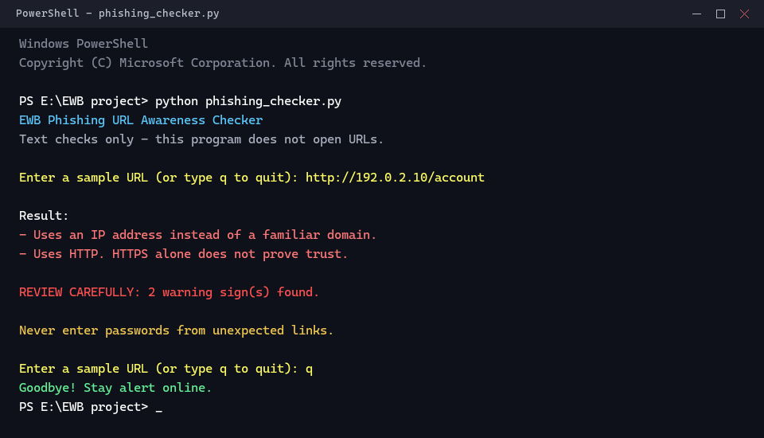
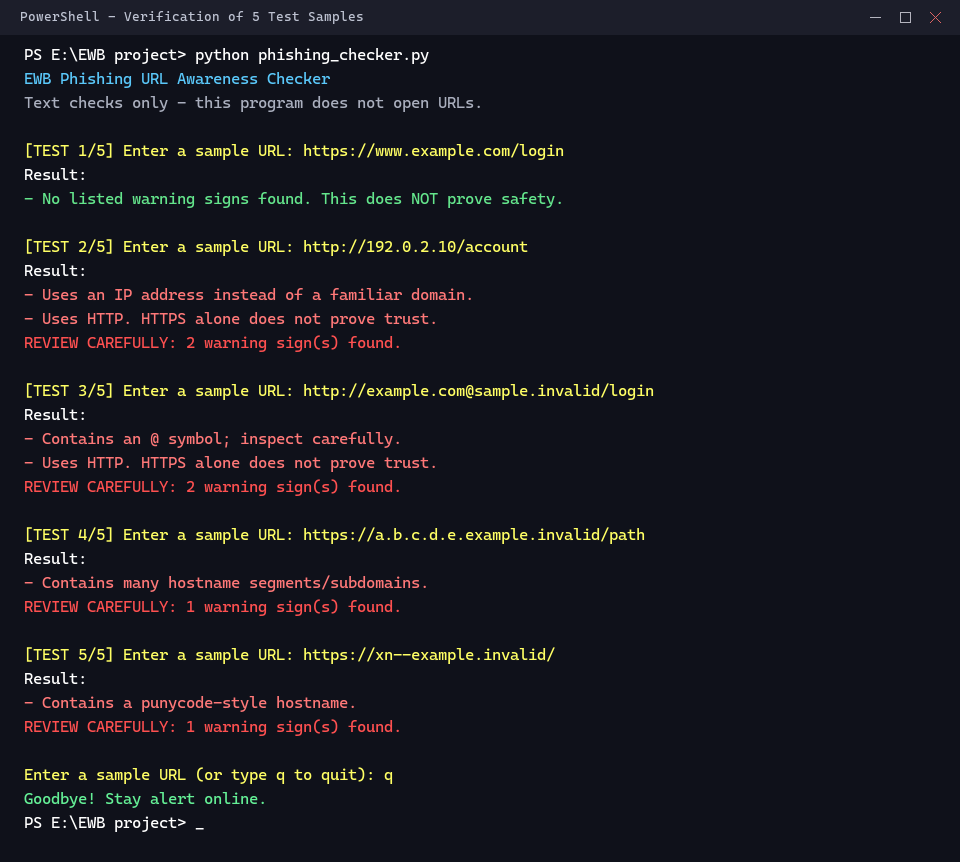

# 🛡️ EWB Phishing URL Awareness Checker

> **Catch phishing traps before they catch you.**  
> A lightweight, defensive URL inspector that spots phishing red flags in seconds—100% offline, reading text only, never touching the live web.

---

## 🌐 Live Test on Netlify
Experience the interactive live web version deployed on Netlify:
- **Instant URL Inspection:** Enter any URL or click the sample buttons from the workbook.
- **Visual Red-Flag Badges:** See pass/fail status for all 6 detection rules in real time.
- **In-Browser Terminal:** Run the exact same CLI experience directly from your browser.

## Features
- **Checks for `@` symbol:** Attackers can use `@` to disguise where the link really leads.
- **Checks URL length:** Flags URLs longer than 100 characters, which can hide the real destination.
- **Checks for IP addresses:** Flags numbers like `192.0.2.10` instead of a normal domain name.
- **Counts domain parts:** Flags hostnames with 5 or more dots/subdomains that try to look official.
- **Checks for punycode (`xn--`):** Flags special look-alike letters used to mimic real websites.
- **Checks for plain HTTP:** Warns when the connection is not encrypted with HTTPS.
- **Repeated checks loop (Improvement 1):** Lets you check multiple links in one go until you type `q` to quit.
- **Warning summary count (Improvement 2):** Clearly counts how many red flags were found so you know to review carefully.
- **Crash protection (Improvement 3):** Handles weird or broken inputs safely without crashing the program.

## Requirements
- Python 3.10 or later
- No extra packages to install (uses standard built-in Python tools)

## How to Run

1. Open your terminal or Command Prompt in this folder.
2. Run the command:
   - **Windows:** `python phishing_checker.py`
   - **Mac / Linux:** `python3 phishing_checker.py`
3. Enter any sample URL to check it, or type `q` to exit.

## Example Output
```text
EWB Phishing URL Awareness Checker
Text checks only - this program does not open URLs.

Enter a sample URL (or type q to quit): http://192.0.2.10/account

Result:
- Uses an IP address instead of a familiar domain.
- Uses HTTP. HTTPS alone does not prove trust.

REVIEW CAREFULLY: 2 warning sign(s) found.

Never enter passwords from unexpected links.

Enter a sample URL (or type q to quit): q
Goodbye! Stay alert online.
```

## Testing
Here are the five test cases from the workbook:

| # | Input | Expected | Actual | Result |
|---|---|---|---|:---:|
| 1 | `https://www.example.com/login` | No warning signs | No listed warning signs found. This does NOT prove safety. | **PASS** |
| 2 | `http://192.0.2.10/account` | IP address + HTTP | Uses an IP address instead of a familiar domain. / Uses HTTP. HTTPS alone does not prove trust. | **PASS** |
| 3 | `http://example.com@sample.invalid/login` | @ symbol + HTTP | Contains an @ symbol; inspect carefully. / Uses HTTP. HTTPS alone does not prove trust. | **PASS** |
| 4 | `https://a.b.c.d.e.example.invalid/path` | Many hostname segments | Contains many hostname segments/subdomains. | **PASS** |
| 5 | `https://xn--example.invalid/` | Punycode hostname | Contains a punycode-style hostname. | **PASS** |

Full testing notes are recorded in [tests/test_samples.md](tests/test_samples.md).

## Screenshots

### 1. Sample Program Run


### 2. Five Test Results


## Improvements
1. **Loop with quit command (Option A):**
   - *What changed:* Added a `while True` loop so you don't have to restart the script for every URL.
   - *Why:* Makes testing fast and convenient.
   - *How tested:* Tested several URLs one after another, then typed `q` to confirm it exits smoothly.

2. **Review carefully summary (Option B):**
   - *What changed:* Added a helper function to count real warnings and show a bold `REVIEW CAREFULLY` notice.
   - *Why:* Quickly tells the user if any real warning signs were found.
   - *How tested:* Checked that clean URLs show no alert, while suspicious links show the exact warning count.

3. **Protection against bad URLs (Option C):**
   - *What changed:* Added `try / except ValueError` around URL parsing.
   - *Why:* Prevents the program from crashing if someone types invalid characters like `http://[bad`.
   - *How tested:* Typed `http://[bad`; the program printed a friendly error message instead of crashing.

## Limitations
This is an educational learning tool. It only reads the plain text of a URL. It **does not** open websites, scan for computer viruses, or guarantee that a link is safe. **"No listed warning signs found" does NOT mean the link is safe.** Always be cautious before clicking any unexpected links.

## Ethical Use
- Use only safe sample links.
- Do not use this tool to attack, probe, or deceive anyone.
- Never enter your real passwords into suspicious websites.

## Author
**Bikash Sarkar**  
GitHub: [@ikash07](https://github.com/ikash07)  
Repository: [phishing-url-awareness](https://github.com/ikash07/EWB-project)  
Course: Cybersecurity Mini Project, EWB Courses
